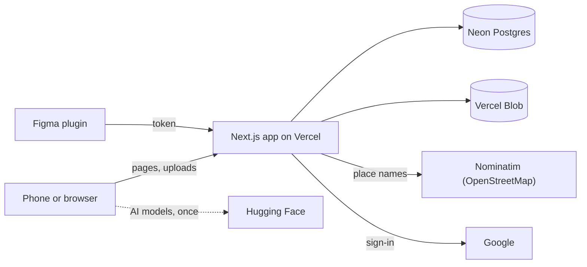

# Sticker Index

Sticker Index is Jacky Lo's personal collection of everyday things, cut out and kept as stickers. Jacky takes a
photo on a phone, the app cuts out the object, and it's saved as a sticker with the day and the area it was found.
Public stickers float on an endless, draggable canvas at **[stickerindex.page](https://stickerindex.page)**. The
camera and the library are private (only Jacky can sign in).

## How it fits together



- **Phone or browser**: takes the photo and cuts out the sticker on the device (iPhone: Apple's Copy Subject;
  others: AI models). Unsent stickers wait in the browser until they upload.
- **Next.js app on Vercel**: the pages and the `/api` routes. Checks who is signed in on every request.
- **Neon Postgres**: one row per sticker (date, place, public or not) and the Figma plugin tokens.
- **Vercel Blob** (private): the sticker images, plus a small public copy of each public sticker.
- **Nominatim**: turns a sticker's location into a place name and area. Only the server asks it.
- **Google**: sign-in. Only the email in `OWNER_EMAIL` is let in.
- **Figma plugin**: lists and inserts stickers in Figma, using a token made in the Library.
- **Hugging Face**: the cut-out models (Android and computers only), downloaded once and cached.

## What lives where

| Folder                | What's in it                                                                                      |
| --------------------- | ------------------------------------------------------------------------------------------------- |
| `app/`                | Pages (`/`, `/gallery`, `/camera`, `/library`, `/history`, `/signin`) and API routes (`app/api/`) |
| `app/globals.css`     | Base styles, colour tokens and the shared buttons and screen layout                               |
| `components/`         | The screens and pieces of UI. Each has its styles next to it in a `*.module.css` file             |
| `content/`            | Words on the public site (the About text)                                                         |
| `lib/config/`         | Settings you might tweak: canvas, sticker style, AI models, devices, limits                       |
| `lib/`                | Everything else the app does: database, uploads, cut-out, location, tokens                        |
| `migrations/`         | Numbered SQL files that change the database (see [Database changes](#database-changes))           |
| `figma-plugin/`       | The private Figma plugin (see [its README](figma-plugin/README.md))                               |
| `scripts/`            | `migrate.mjs` (database changes) and `build-plugin.mjs` (sticker style for the Figma plugin)      |
| `test/`               | Automated tests                                                                                   |
| `auth.ts`, `proxy.ts` | Sign-in, and the check that runs before every page and API request                                |

## Privacy

- **Photos never leave the phone.** Only the cut-out sticker is uploaded.
- **Only the owner signs in.** Camera, Library, History and the API need the `OWNER_EMAIL` Google account (or a
  Figma plugin token, for a few read and delete calls).
- **The public sees small copies only.** Making a sticker public uploads a 600px copy; originals are never served
  to visitors.
- **No exact place or time in public.** Visitors see the day and a coarse area (e.g. "Mong Kok, Hong Kong"),
  never coordinates, the place name or the time. `test/privacy.test.tsx` checks this.
- **Kept out of search engines.** Every page and image says `noindex`; Figma tokens are stored only as a hash.

## Checks

Every pull request (and every push to `main`) runs these on GitHub. A red ✗ on the PR means one failed; click
**Details** to see which. `main` only accepts changes once they pass.

- **Typecheck** (`tsc`): the code's types fit together.
- **Lint** (ESLint, with accessibility rules): catches likely bugs and React/Next.js mistakes.
- **Format check** (Prettier): the code is formatted the same way everywhere.
- **Test** (Vitest): sign-in rules, privacy, uploads, accessibility, the Figma plugin and more.
- **Build** (`next build`): the site still builds, like on Vercel.

To run them on your own computer (needs Node 26, see `.nvmrc`):

```bash
npm run check
```

```bash
npm run build
```

`npm run format` fixes formatting for you. `npm run lint -- --fix` fixes some lint problems.

## Database changes

Every change to the database is a numbered SQL file in `migrations/`. The table
`schema_migrations` remembers which files have run, so each runs only once.

**Adding one**

1. Make the next file, e.g. `migrations/0005_add_something.sql` (next number, no gaps).
2. Start it with a `--` comment saying why it exists.
3. Keep it safe to run twice: `CREATE TABLE IF NOT EXISTS`, `ADD COLUMN IF NOT EXISTS`,
   and an `UPDATE` only with `WHERE … IS NULL`. The tests check this.
4. Put it in the same PR as the code that needs it.

**Running it** (after the PR is merged)

1. GitHub → **Actions** → **Migrate** → **Run workflow**.
2. Pick `dry-run` first. The log lists each file as `already applied` or `would run`.
3. If that looks right, run it again with `apply`. Each file runs in its own transaction;
   if one fails, it stops there and nothing from that file is saved.

Merging deploys the new code right away, and it may fail until the new columns exist,
so run `apply` soon after merging.

Vercel builds never touch the database: previews and production share it, so changes
only happen when you run **Migrate** by hand.

## Figma plugin

A private plugin that lists your stickers in Figma and drops them into the file, with or without the border and
shadow. How to install and use it: [`figma-plugin/README.md`](figma-plugin/README.md).

Its sticker style is copied from `lib/` by `npm run build:plugin`. The tests fail if you change the style and forget
to run it.

## Where to change things

| To change…                                   | Edit                                                                       |
| -------------------------------------------- | -------------------------------------------------------------------------- |
| About text, button label, credit line        | `content/about.ts`                                                         |
| Link colour in About                         | `linkColor` in `content/about.ts`                                          |
| Canvas spacing, sticker size, colours, glide | `CANVAS` in `lib/config/canvas.ts`                                         |
| Sticker border and shadow                    | `STYLE` in `lib/config/sticker-style.ts`, then run `npm run build:plugin`  |
| Fonts and colours across the site            | The tokens at the top of `app/globals.css`                                 |
| One screen's look                            | The `*.module.css` next to it, e.g. `components/InfiniteCanvas.module.css` |

## Run it locally

```bash
npm install
```

```bash
npm run dev
```

Then open http://localhost:3000. On a computer without a camera, use **Choose from library**. Signing in and saving
need the setup below and a `.env.local` (copy `.env.example`).

## Setup (sign-in, storage, database)

Do these once. Nothing here is created automatically.

### 1. Storage (Vercel dashboard → your `sticker-camera` project → **Storage** tab)

1. **Create → Blob.** Choose **Private** access. Connect it to the project for all environments.
   This adds `BLOB_READ_WRITE_TOKEN` for you.
2. **Create → Neon (Postgres).** Connect it to the project for all environments.
   This adds `DATABASE_URL` for you.

### 2. Create the database tables

1. In Neon → your project → **Connection details**, copy the connection string.
   (Vercel hides "Sensitive" values, so copy it from Neon.)
2. In GitHub → this repo → Settings → Secrets and variables → Actions → **New repository secret**,
   name it `DATABASE_URL` and paste the connection string.
3. Run the **Migrate** action with `apply` (see [Database changes](#database-changes)).

### 3. Google sign-in (Google Cloud Console → APIs & Services)

1. **OAuth consent screen:** type _External_. Under _Test users_, add your own Google email.
2. **Credentials → Create credentials → OAuth client ID → Web application.**
   - Authorized JavaScript origins:
     - `https://stickerindex.page`
     - `http://localhost:3000`
   - Authorized redirect URIs:
     - `https://stickerindex.page/api/auth/callback/google`
     - `http://localhost:3000/api/auth/callback/google`
   - Preview deployments need no extra URIs: they sign in through the production domain
     (see `AUTH_REDIRECT_PROXY_URL` below).
3. Copy the **Client ID** and **Client secret**.

### 4. Environment variables (Vercel → Settings → Environment Variables)

Set each one for **Production** and **Preview**:

| Name                      | Value                                                               |
| ------------------------- | ------------------------------------------------------------------- |
| `AUTH_SECRET`             | a random secret: run `npx auth secret` or `openssl rand -base64 33` |
| `AUTH_GOOGLE_ID`          | Google Client ID                                                    |
| `AUTH_GOOGLE_SECRET`      | Google Client secret                                                |
| `OWNER_EMAIL`             | your Google email (the only account allowed in)                     |
| `AUTH_REDIRECT_PROXY_URL` | `https://stickerindex.page/api/auth`                                |

`DATABASE_URL` and `BLOB_READ_WRITE_TOKEN` are already there from step 1.
Then redeploy (Deployments → ⋯ → Redeploy) so the new values are used.

### Running locally with sign-in

Fill in `.env.local` (all of the above except `AUTH_REDIRECT_PROXY_URL`), then `npm run dev`.
